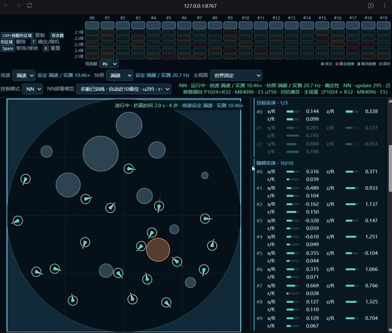
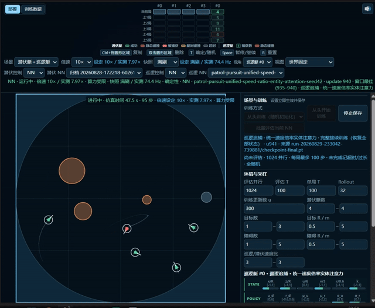
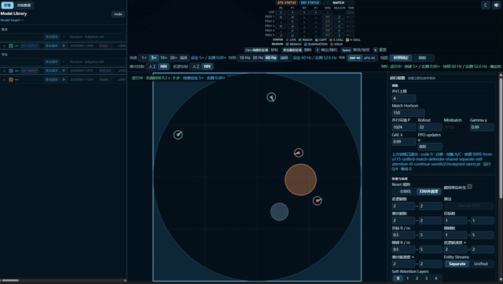
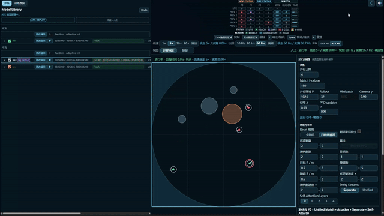
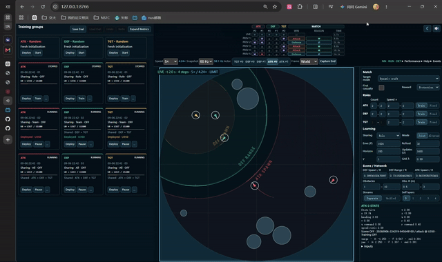
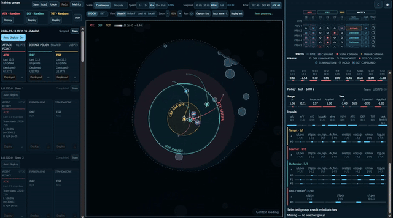

# AUV-MADRL Showcase

A personal engineering exploration of multi-vessel simulation and multi-agent attack-defense self-play, led by **lvdacong**. The work brings together simulation, reinforcement learning training, model deployment, and interactive visualization to demonstrate software implementation and system integration.

The author directed and assembled this workflow with AI coding assistance for implementation and debugging, and personally recorded the demonstrations. Third-party libraries and assets are credited separately.

**The project is currently on hold, and no related research paper has been published.** These demonstrations document exploratory behavior; they do not establish policy convergence, optimality, generalization, or real-vessel effectiveness.

## Demonstrations

The six recordings follow the author's selected progression, from cooperative obstacle avoidance to three-role self-play. The first five titles describe historical explorations, including working interpretations that have not been independently validated.

The GIFs below are silent excerpts. Each caption states the selected source interval and playback speed; speed is relative to the recorded video, not physical simulation time. Click any preview or its video link to access the full MP4 recording with audio.

### 1. Cooperative obstacle avoidance

[](docs/videos/01-cooperative-obstacle-avoidance.mp4)

Source: 2.75–14.21 s · **2× playback** · GIF: 5.7 s, 1.74 MiB · [Full recording (51.6 s)](docs/videos/01-cooperative-obstacle-avoidance.mp4)

### 2. Chasing shadows

[](docs/videos/02-chasing-shadows.mp4)

Source: 0.00–8.00 s · **1.5× playback** · GIF: 5.3 s, 1.28 MiB · [Full recording (9.1 s)](docs/videos/02-chasing-shadows.mp4)

### 3. Attack-defense self-play: a later DEF policy checkpoint

[](docs/videos/03-attack-defense-self-play.mp4)

Source: 0.00–8.00 s · **2× playback** · GIF: 4.0 s, 0.52 MiB · [Full recording (18.5 s)](docs/videos/03-attack-defense-self-play.mp4)

### 4. ATK-DEF automatic formation

[](docs/videos/04-automatic-formation.mp4)

Source: 0.45–19.80 s · **2× playback** · GIF: 9.7 s, 0.54 MiB · [Full recording (25.8 s)](docs/videos/04-automatic-formation.mp4)

### 5. Target-assisted defender learning

[](docs/videos/05-target-assisted-learning.mp4)

Source: 3.55–17.11 s · **1.5× playback** · GIF: 9.1 s, 2.03 MiB · [Full recording (23.3 s)](docs/videos/05-target-assisted-learning.mp4)

### 6. Three-role, two-team self-play — current showcase

[](docs/videos/06-three-role-two-team-self-play.mp4)

Source: 0.00–13.81 s · **1× playback** · GIF: 13.8 s, 5.02 MiB · [Full recording (16.0 s)](docs/videos/06-three-role-two-team-self-play.mp4)

The six previews total approximately 11.1 MiB. Original recordings are preserved byte-for-byte. See the [recording manifest](docs/videos/manifest.json) and [preview manifest](docs/previews/manifest.json) for source ranges, playback speeds, file sizes, and SHA-256 checksums.

## Repository scope

This standalone showcase contains the Python source, selected tests, configuration, a fixed checkpoint, Viewer assets, recordings, and GIF previews needed to present the current implementation. It starts from an independent initial commit; the original project's Git history, full-text papers, field-recorded ROS bags, and training logs are excluded.

## Model and quick start

The current demonstration uses the existing **U13773** checkpoint from training group `20260913-103135-634244600`: **2 attackers (ATK), 3 defenders (DEF), and 1 dynamic target (TGT)**. ATK uses the `attack` parameter group; DEF and TGT share the `defense` parameter group. U13773 is the checkpoint's global update index, not a claim that every role received an equal number of independent training updates. Provenance, configuration, and checksums are in the [model manifest](docs/showcase-model.json).

No retraining or algorithm, scene, or Viewer changes were made for this showcase release.

On Windows, install Git and [uv](https://docs.astral.sh/uv/), then run the following in PowerShell. The fixed checkpoint is included in Git and needs no separate download.

```powershell
git clone https://github.com/lvdacong/AUV-MADRL-Showcase.git
Set-Location AUV-MADRL-Showcase\Python
uv sync --locked
Set-Location src
..\.venv\Scripts\python.exe -m auv_madrl goal-reach-viewer --port 8766 --checkpoint ..\..\Artifacts\GoalReach\20260913-103135-634244600-unified-match-seed42\checkpoint-013773.pt
```

Open the [local Viewer](http://127.0.0.1:8766/) in Chrome. Confirm that ATK, DEF, and TGT have loaded their models, then use **Run** to start the simulation. The initial state is paused. **Train / Start** controls training and is separate from simulation playback. The recorded Viewer interface retains its original language.

Python and dependency versions are specified in `Python/pyproject.toml` and `Python/uv.lock`. The showcase was verified in the author's Windows environment; other platforms have not been validated.

Run `uv run pytest -q` from the `Python` directory to execute the included tests. The [release verification record](docs/verification.json) documents environment setup, model initialization, file checks, and the scope and limitations of prior test results.

## Attribution and rights

Copyright © 2026 lvdacong. **All rights reserved.** The author's original code, documentation, model weights, and original contributions to recordings and previews are covered by [LICENSE](LICENSE). Public access does not grant additional permission to modify, redistribute, or commercially use these contributions. Contact the author for reuse permission, and retain attribution and source references. See [CITATION.cff](CITATION.cff) for citation metadata.

The rights declaration is not a copyright-registration certificate. Git history and checksums support version provenance; they do not guarantee protection against plagiarism.

Third-party music and dependencies retain their own terms. See [Third-party notices](docs/THIRD_PARTY_NOTICES.md) for Kevin MacLeod's music credits and license. The author's rights declaration covers only original contributions, not third-party audio or imagery.
